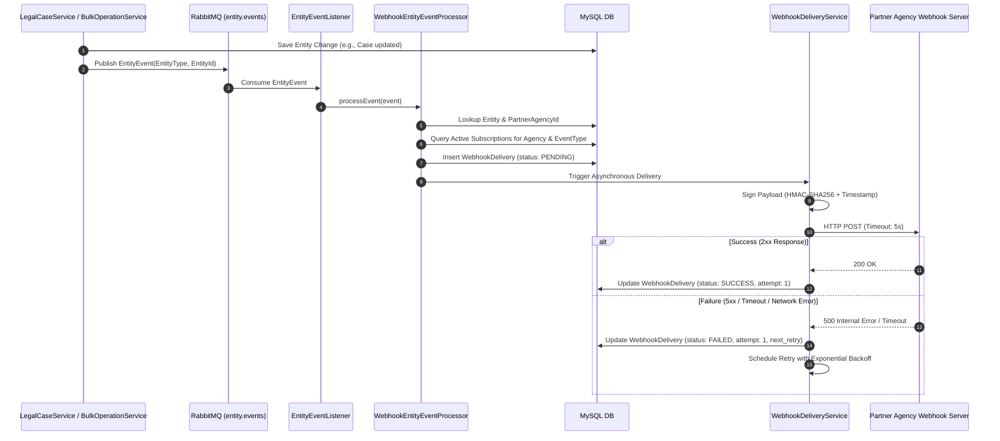

# Technical Specification: CaseForce Webhook Delivery System & Bulk Operations API
**Project:** `alns-caseforce-legalhub`  
**Author:** Senior Backend & Distributed Systems Specialist (Antigravity)  
**Status:** DRAFT / PENDING VALIDATION  
**Date:** 2026-08-25  

---

## 1. Executive Summary & Objectives

The goal of this project is to extend **Caseforce** (the case management backend platform for law firms and partner agencies) with three key capabilities:
1. **Interactive API Documentation & Testing (OpenAPI 3 & Swagger UI):** Embedded interactive Swagger UI and OpenAPI 3 schema generation to discover, explore, and test all REST endpoints directly in the browser.
2. **Webhook Delivery System (Part 1 - Required):** An event-driven, secure, resilient, and observable HTTP webhook notification mechanism that informs partner agencies in real-time when events occur on their legal cases and actions.
3. **Bulk Operations API (Part 2 - Bonus):** An asynchronous bulk case reassignment service capable of handling hundreds of cases reliably, reporting fine-grained job status, and emitting entity events that seamlessly fan out to the webhook delivery pipeline.

---

## 2. Architectural Design & System Components

### 2.1 High-Level Architecture Diagram

```mermaid
flowchart TD
    subgraph Clients["Client Layer"]
        Agency["Partner Agency / Internal User"]
    end

    subgraph RestAPI["Caseforce REST API (Micronaut 4)"]
        CaseCtrl["LegalCaseController / ActionController"]
        SubCtrl["WebhookSubscriptionController"]
        BulkCtrl["BulkOperationController"]
    end

    subgraph CoreServices["Domain & Service Layer"]
        CaseSvc["LegalCaseService"]
        SubSvc["WebhookSubscriptionService"]
        BulkSvc["BulkOperationService"]
        DelivSvc["WebhookDeliveryService"]
        Signer["WebhookSigner (HMAC-SHA256)"]
        Validator["UrlSecurityValidator (SSRF Protection)"]
    end

    subgraph Messaging["Message Broker"]
        RabbitMQ["RabbitMQ Topic Exchange (entity.events)"]
    end

    subgraph EventConsumers["Event Listeners & Adapters"]
        EvtListener["EntityEventListener (RabbitMQ Adapter)"]
        EvtProcessor["WebhookEntityEventProcessor (Domain)"]
    end

    subgraph Database["MySQL 8 (Micronaut Data JDBC)"]
        DBCase[("tb_legal_case / action")]
        DBSub[("tb_webhook_subscription")]
        DBDeliv[("tb_webhook_delivery")]
        DBJob[("tb_bulk_operation_job")]
    end

    subgraph ExternalWebhooks["Partner Endpoints"]
        PartnerURL["Partner Agency Webhook Server"]
    end

    %% Flow interactions
    Agency -->|CRUD Case/Action| CaseCtrl
    Agency -->|Register Webhook| SubCtrl
    Agency -->|Trigger Bulk Reassign| BulkCtrl

    CaseCtrl --> CaseSvc
    SubCtrl --> SubSvc
    BulkCtrl --> BulkSvc

    SubSvc --> Validator
    SubSvc --> DBSub

    CaseSvc --> DBCase
    CaseSvc -->|Publish EntityEvent| RabbitMQ

    BulkSvc --> DBJob
    BulkSvc --> DBCase
    BulkSvc -->|Publish EntityEvents| RabbitMQ

    RabbitMQ --> EvtListener
    EvtListener --> DBSub
    EvtListener --> DBDeliv
    EvtListener --> DelivSvc

    DelivSvc --> Signer
    DelivSvc -->|Async HTTP POST (HMAC Signed)| PartnerURL
    DelivSvc -->|Update Status & Logs| DBDeliv
```

---

## 3. Data Model & Database Migrations

### 3.1 Database Migration: `V3__webhook_and_bulk_operations.sql`

We will introduce 3 new database tables, with foreign keys, cascading deletions, and indexes tailored for query access patterns:

#### Table 1: `tb_webhook_subscription`
Stores the partner agency's webhook endpoint registrations.
- `id` (BIGINT, PRIMARY KEY, AUTO_INCREMENT)
-- `partner_agency_id` (BIGINT, NOT NULL, FK -> `tb_partner_agency(id)` ON DELETE CASCADE)
- `ds_target_url` (VARCHAR(1024), NOT NULL)
- `ds_secret` (VARCHAR(255), NOT NULL, used for HMAC-SHA256 payload signing)
- `js_event_types` (JSON, NOT NULL, e.g. `["LEGAL_CASE_CREATED", "LEGAL_CASE_UPDATED", "ACTION_CREATED", "ACTION_UPDATED"]`)
- `en_status` (VARCHAR(50), NOT NULL DEFAULT 'ACTIVE' - enum: `ACTIVE`, `INACTIVE`, `SUSPENDED`)
- `ts_date_created` (TIMESTAMP DEFAULT CURRENT_TIMESTAMP)
- `ts_date_updated` (TIMESTAMP DEFAULT CURRENT_TIMESTAMP ON UPDATE CURRENT_TIMESTAMP)
- `ts_date_deleted` (TIMESTAMP NULL)
- **Indexes:**
  - `idx_webhook_sub_agency (partner_agency_id, en_status)`
  - `idx_webhook_sub_deleted (ts_date_deleted)`

#### Table 2: `tb_webhook_delivery`
Maintains the complete history and audit trail of webhook delivery attempts, enabling diagnostics, retries, and observability.
- `id` (BIGINT, PRIMARY KEY, AUTO_INCREMENT)
-- `subscription_id` (BIGINT, NOT NULL, FK -> `tb_webhook_subscription(id)` ON DELETE CASCADE)
- `ds_event_type` (VARCHAR(50), NOT NULL)
- `ds_entity_type` (VARCHAR(50), NOT NULL)
- `nm_entity_id` (BIGINT, NOT NULL)
- `js_payload` (JSON, NOT NULL)
- `en_status` (VARCHAR(50), NOT NULL DEFAULT 'PENDING' - enum: `PENDING`, `SUCCESS`, `FAILED`)
- `nr_attempt_count` (INT NOT NULL DEFAULT 0)
- `ts_last_attempt_at` (TIMESTAMP NULL)
- `nr_response_status_code` (INT NULL)
- `tx_response_body` (TEXT NULL)
- `tx_error_message` (TEXT NULL)
- `ts_date_created` (TIMESTAMP DEFAULT CURRENT_TIMESTAMP)
- `ts_date_updated` (TIMESTAMP DEFAULT CURRENT_TIMESTAMP ON UPDATE CURRENT_TIMESTAMP)
- **Indexes:**
  - `idx_webhook_deliv_sub (subscription_id)`
  - `idx_webhook_deliv_status_attempt (en_status, ts_last_attempt_at)`
  - `idx_webhook_deliv_created (ts_date_created)`

#### Table 3: `tb_bulk_operation_job`
Tracks asynchronous execution of bulk operations (e.g., bulk case reassignment).
- `id` (BIGINT, PRIMARY KEY, AUTO_INCREMENT)
- `ds_job_type` (VARCHAR(50), NOT NULL DEFAULT 'CASE_REASSIGNMENT')
- `en_status` (VARCHAR(50), NOT NULL DEFAULT 'PENDING' - enum: `PENDING`, `IN_PROGRESS`, `COMPLETED`, `FAILED`)
- `requested_by_id` (BIGINT NOT NULL, FK -> `tb_user(id)` ON DELETE CASCADE)
- `js_filter_criteria` (JSON NOT NULL)
- `target_lawyer_id` (BIGINT NOT NULL, FK -> `tb_user(id)` ON DELETE CASCADE)
- `nr_total_count` (INT NOT NULL DEFAULT 0)
- `nr_processed_count` (INT NOT NULL DEFAULT 0)
- `nr_success_count` (INT NOT NULL DEFAULT 0)
- `nr_failed_count` (INT NOT NULL DEFAULT 0)
- `js_error_summary` (JSON NULL)
- `ts_date_created` (TIMESTAMP DEFAULT CURRENT_TIMESTAMP)
- `ts_date_updated` (TIMESTAMP DEFAULT CURRENT_TIMESTAMP ON UPDATE CURRENT_TIMESTAMP)
- **Indexes:**
  - `idx_bulk_job_status (en_status)`
  - `idx_bulk_job_user (requested_by_id)`

---

## 4. API Endpoints Specification & Interactive Documentation

### 4.0 OpenAPI 3.0 & Swagger UI Integration
To provide full discoverability and in-browser manual testing:
- **Swagger UI Path:** `http://localhost:5000/swagger-ui/index.html` (or `/swagger-ui`)
- **OpenAPI JSON Spec:** `http://localhost:5000/swagger/caseforce-legal-hub-1.0.0.yml` (or `.json`)
- **Security Scheme:** JWT Bearer Token (`BearerAuth`), enabling immediate authorization in Swagger UI via the "Authorize" button using tokens acquired from `/login`.
- **Static Resource Routing:** Enabled via Micronaut router configuration with anonymous access permitted for `/swagger-ui/**` and `/swagger/**`.

### 4.1 Webhook Subscription Management API

Base path: `/webhooks/subscriptions` (Secured with `@Secured` and permissions)

| Method | Endpoint | Permission | Description |
|---|---|---|---|
| `POST` | `/webhooks/subscriptions` | `WEBHOOK_CREATE` | Register a new webhook endpoint for a partner agency |
| `GET` | `/webhooks/subscriptions/{id}` | `WEBHOOK_GET` | Get details of a webhook subscription |
| `GET` | `/webhooks/subscriptions` | `WEBHOOK_LIST` | List subscriptions (optionally filtered by `partnerAgencyAlias`) |
| `PUT` | `/webhooks/subscriptions/{id}` | `WEBHOOK_UPDATE` | Update target URL, secret, event types, or status |
| `DELETE` | `/webhooks/subscriptions/{id}` | `WEBHOOK_DELETE` | Soft-delete a webhook subscription |

#### Registration Request Payload:
```json
{
  "partnerAgencyId": 1,
  "targetUrl": "https://api.partneragency.com/caseforce/events",
  "secret": "whsec_superSecretPartnerKey_123",
  "eventTypes": [
    "LEGAL_CASE_CREATED",
    "LEGAL_CASE_UPDATED",
    "ACTION_CREATED",
    "ACTION_UPDATED"
  ]
}
```

### 4.2 Webhook Delivery Audit API

| Method | Endpoint | Permission | Description |
|---|---|---|---|
| `GET` | `/webhooks/subscriptions/{subscriptionId}/deliveries` | `WEBHOOK_GET` | List delivery attempts for a subscription |
| `GET` | `/webhooks/deliveries/{id}` | `WEBHOOK_GET` | Get specific delivery attempt log |
| `POST` | `/webhooks/deliveries/{id}/retry` | `WEBHOOK_UPDATE` | Manually re-trigger a failed delivery |

### 4.3 Bulk Operations API

Base path: `/cases/bulk-reassign`

| Method | Endpoint | Permission | Description |
|---|---|---|---|
| `POST` | `/cases/bulk-reassign` | `CASE_UPDATE` | Trigger bulk case reassignment (async job) |
| `GET` | `/cases/bulk-reassign/{jobId}` | `CASE_GET` | Get bulk job execution status and results |

#### Bulk Reassignment Request Payload:
```json
{
  "targetLawyerId": 5,
  "filter": {
    "currentLawyerId": 2,
    "partnerAgencyId": 1,
    "legalField": "RENTAL_LAW",
    "status": "OPEN"
  }
}
```

#### Bulk Reassignment Response (202 Accepted):
```json
{
  "jobId": 42,
  "status": "IN_PROGRESS",
  "totalCount": 150,
  "processedCount": 0,
  "successCount": 0,
  "failedCount": 0,
  "createdAt": "2026-08-25T12:00:00Z"
}
```

---

## 5. Security & Verification Architecture

### 5.1 HMAC-SHA256 Signature Specification
To ensure authenticity, integrity, and replay-attack protection, every outbound webhook request contains:
- `X-Caseforce-Signature-256`: `sha256=<hex-digest>` where digest is `HMAC_SHA256(secret, timestamp + "." + raw_payload)`
- `X-Caseforce-Timestamp`: UNIX Epoch in milliseconds
- `X-Caseforce-Event`: Event identifier (e.g., `LEGAL_CASE_UPDATED`)
- `X-Caseforce-Delivery-Id`: Unique delivery ID (for deduplication / idempotency)
- `Content-Type`: `application/json`

### 5.2 Server-Side Request Forgery (SSRF) Defense
The `UrlSecurityValidator` validates `targetUrl` before registration and delivery:
1. Protocol whitelist: only `http` and `https` allowed (https enforced for non-local profiles).
2. Hostname resolution check: rejects loopback (`127.0.0.0/8`, `localhost`, `::1`), link-local / cloud metadata (`169.254.169.254`), and private RFC 1918 ranges unless explicitly permitted in development mode.

### 5.3 RBAC & Authorization
- Extend `Permission` enum with:
  - `WEBHOOK_CREATE`, `WEBHOOK_GET`, `WEBHOOK_UPDATE`, `WEBHOOK_DELETE`, `WEBHOOK_LIST`
- All endpoints enforced via `@Secured` and `@NeedsPermission`.

---

## 6. Webhook Delivery Lifecycle & Resilience



### 6.1 Retry Strategy & Exponential Backoff
- Deliveries are executed non-blocking via Micronaut Reactor HTTP client / Reactor `Mono`.
- Configurable maximum retries (default: 3).
- Backoff progression:
  - Attempt 1: Immediate upon event ingestion.
  - Attempt 2: +2 seconds delay.
  - Attempt 3: +10 seconds delay.
  - Attempt 4 (final): +30 seconds delay.
- Non-retryable errors: HTTP 400, 401, 403, 404, 410, 422 (permanent partner errors are immediately marked `FAILED` without retrying).

---

## 7. Testing Strategy

1. **Unit Tests:**
   - `WebhookSignerSpec`: Tests HMAC signature generation, timestamp formatting, and verification logic.
   - `UrlSecurityValidatorSpec`: Validates SSRF prevention rules against various malicious/internal URLs.
2. **Integration Tests (Spock + TestContainers MySQL 8):**
   - `WebhookSubscriptionControllerSpec`: Tests full CRUD operations, authentication, and validation.
   - `WebhookDeliveryIntegrationSpec`: Tests full end-to-end flow: Case update -> Event ingestion -> Subscribed partner lookup -> Delivery log generation -> Mock HTTP server payload & HMAC signature verification.
   - `BulkCaseReassignmentSpec`: Tests bulk reassignment logic, async job progress polling, and verification that individual entity events are emitted.

---

## 8. Simulation Module: Fake Legal Partner Agency (`fake-legal-partner-agency`)

To provide an end-to-end sandbox demonstrating how real law firms integrate with CaseForce, a companion simulation module is included.

### 8.1 Module Architecture & Tech Stack
- **Module Directory:** `03-techstuff/fake-legal-partner-agency`
- **Language & Runtime:** Java 25
- **Framework:** Spring Boot 4.1.1 (with `spring-boot-starter-web`, `spring-boot-starter-data-jpa`, `spring-boot-starter-validation`)
- **Build Tool:** Apache Maven 3.9.5 (with `pom.xml` and `mvnw` wrapper)
- **Database:** H2 In-Memory Database (`jdbc:h2:mem:partnerdb`) with H2 Console enabled at `/h2-console`
- **Port:** Configured on port `8081` (avoiding collision with Caseforce on port `5000`)
- **API Documentation:** SpringDoc OpenAPI 3 / Swagger UI (`/swagger-ui.html`)

### 8.2 Domain & Data Model (H2 JPA)
1. **Entity `PartnerSubscriptionConfig`:**
   - Stores configuration for each simulated partner agency:
     - `partnerAgencyAlias`: Long (PK / unique identifier matching CaseForce's `partner_agency.id`)
     - `agencyName`: String
     - `caseforceBaseUrl`: String (default: `http://localhost:5000`)
     - `webhookSecret`: String (shared secret for HMAC verification)
     - `subscribedEvents`: String / JSON list of subscribed event names
     - `targetWebhookUrl`: String (e.g., `http://localhost:8081/api/agencies/{partnerAgencyId}/webhooks/caseforce`)
2. **Entity `ReceivedWebhookEvent`:**
   - Stores incoming webhooks received from Caseforce per agency:
     - `id`: Long (PK)
     - `partnerAgencyAlias`: Long (indexed, associated agency)
     - `deliveryId`: String (from header `X-Caseforce-Delivery-Id`)
     - `eventType`: String (from header `X-Caseforce-Event`)
     - `timestamp`: Long (from header `X-Caseforce-Timestamp`)
     - `signature`: String (from header `X-Caseforce-Signature-256`)
     - `isSignatureValid`: Boolean
     - `rawPayload`: CLOB / TEXT
     - `receivedAt`: LocalDateTime
     - `processedStatus`: String (`RECEIVED`, `PROCESSED`, `VERIFICATION_FAILED`)

### 8.3 Endpoints (Scoped by `partner-agency-id`)
All endpoints are scoped by `{partnerAgencyId}` path parameter to support multi-agency simulation:

| Method | Endpoint | Description |
|---|---|---|
| `POST` | `/api/agencies/{partnerAgencyId}/webhooks/caseforce` | Multi-tenant Webhook Receiver: validates HMAC-SHA256 signature using the secret configured for that specific agency, logs headers, persists incoming payload in H2, and returns 200 OK. |
| `GET` | `/api/agencies/{partnerAgencyId}/webhooks/events` | List all received webhooks for a specific partner agency with signature verification status and payloads. |
| `GET` | `/api/agencies/{partnerAgencyId}/webhooks/events/{id}` | Retrieve full details of a specific received webhook event for the given agency. |
| `DELETE` | `/api/agencies/{partnerAgencyId}/webhooks/events` | Clear received events log in H2 for the given agency. |
| `POST` | `/api/agencies/{partnerAgencyId}/subscribe` | Automation client: calls Caseforce REST API (`/webhooks/subscriptions`) using JWT authentication to automatically register the agency's specific webhook URL. |
| `GET` | `/api/agencies/{partnerAgencyId}/config` | Get the simulation configuration for a given agency. |
| `PUT` | `/api/agencies/{partnerAgencyId}/config` | Create or update simulation configuration (secret, subscribed events, target URL) for a given agency. |

### 8.4 Security & Signature Verification in Java 25
The receiver implements an `HmacSignatureVerifier` component:
- Resolves the `PartnerSubscriptionConfig` corresponding to `{partnerAgencyId}`.
- Reads `X-Caseforce-Signature-256` and `X-Caseforce-Timestamp`.
- Calculates `HMAC-SHA256` using `javax.crypto.Mac` on `timestamp + "." + rawBody` with the agency's configured secret.
- Performs constant-time comparison via `MessageDigest.isEqual` to prevent timing attacks.
- Rejects requests if the timestamp is older than 5 minutes (replay attack defense).
- Flags `isSignatureValid` as `true` / `false` in the `ReceivedWebhookEvent` audit log.