# Implementation Plan: CaseForce Webhook Delivery System & Bulk Operations API
**Project:** `alns-caseforce-case-study`  
**Core Service Module:** `caseforce-legalhub-mgmt`  
**Simulation Module:** `fake-helpers-apps/fake-legal-partners-agencies-app`  
**Spec Reference:** `specs/01-initial-spec.md`  
**Date:** 2026-08-25  

---

## 1. Plan Overview & Execution Strategy

This implementation plan breaks down the development of the Webhook Delivery System (Part 1 - Core) and the Bulk Operations API (Part 2 - Bonus) into sequential, verifiable phases. Each phase culminates in a clear deliverable and testing checkpoint following the Spec-Driven Development (SDD) workflow defined in `AGY.md`.

---

## 2. Phase-by-Phase Breakdown

```mermaid
gantt
    title Implementation Roadmap
    dateFormat  X
    axisFormat %s

    section Phase 0: OpenAPI & Swagger UI
    OpenAPI Deps & Swagger UI Config    :p0_1, 0, 1
    OpenAPIDefinition & SecurityScheme  :p0_2, after p0_1, 1

    section Phase 1: Database & Entities
    Flyway Migration (V3)               :p1_1, after p0_2, 1
    Domain Models & JDBC Repositories   :p1_2, after p1_1, 1

    section Phase 2: Security & Utilities
    Permission Enum Expansion          :p2_1, after p1_2, 1
    HMAC-SHA256 Signer                 :p2_2, after p2_1, 1
    SSRF URL Validator                 :p2_3, after p2_2, 1

    section Phase 3: Webhook API & CRUD
    Subscription DTOs & Service        :p3_1, after p2_3, 1
    Webhook Controller & Permissions   :p3_2, after p3_1, 1

    section Phase 4: Delivery Engine
    RabbitMQ Event Listener            :p4_1, after p3_2, 1
    Async Delivery Service & Retries   :p4_2, after p4_1, 1

    section Phase 5: Bulk Operations
    Bulk Reassign API & Service        :p5_1, after p4_2, 1
    Bulk Progress & Event Triggering   :p5_2, after p5_1, 1

    section Phase 6: Testing & Specs
    Spock End-to-End Tests             :p6_1, after p5_2, 1

    section Phase 7: Architecture Docs
    DECISIONS.md & Architecture Review :p7_1, after p6_1, 1

    section Phase 8: Fake Partner Agency
    Maven / Spring Boot / Java Setup   :p8_1, after p7_1, 1
    H2 Storage & Webhook Receiver API   :p8_2, after p8_1, 1
    CaseForce Client & E2E Verification :p8_3, after p8_2, 1
```

---

### Phase 0: OpenAPI 3 & Swagger UI Setup (Prerequisite)
- **Task 0.1:** Add OpenAPI dependencies & compiler processors to `caseforce-legalhub-mgmt/build.gradle.kts`:
  - `kapt("io.micronaut.openapi:micronaut-openapi")`
  - `compileOnly("io.micronaut.openapi:micronaut-openapi-annotations")`
  - Configure kapt arguments for generating Swagger UI (`swagger-ui.enabled=true,swagger-ui.theme=flattop`).
- **Task 0.2:** Configure static resources and routing in `caseforce-legalhub-mgmt/src/main/resources/application.yml`:
  - Map static resource paths `/swagger/**` and `/swagger-ui/**`.
  - Configure security rules to allow anonymous access to `/swagger/**` and `/swagger-ui/**`.
- **Task 0.3:** Annotate `Application.kt` with `@OpenAPIDefinition` and `@SecurityScheme` (Bearer JWT) for easy authorization in Swagger UI.
- **Task 0.4:** Annotate existing `LegalCaseController` and `ActionController` with OpenAPI tags/operations, verify `./gradlew compileKotlin` and validate Swagger UI availability.

---

### Phase 1: Database Migration, Entities & Repositories
- **Task 1.1:** Create Flyway migration `V3__webhook_and_bulk_operations.sql` in `caseforce-legalhub-mgmt/src/main/resources/databasemigrations/`:
  - Table `tb_webhook_subscription`:
    - `id` (BIGINT PK AUTO_INCREMENT)
    - `partner_agency_id` (BIGINT FK to `tb_partner_agency(id)`)
    - `ds_target_url` (VARCHAR(2048) NOT NULL)
    - `ds_secret` (VARCHAR(255) NOT NULL)
    - `js_event_types` (JSON NOT NULL)
    - `en_status` (VARCHAR(32) NOT NULL DEFAULT 'ACTIVE')
    - `ts_date_created` (DATETIME NOT NULL)
    - `ts_date_updated` (DATETIME NOT NULL)
    - `ts_date_deleted` (DATETIME NULL)
    - Indexes: `idx_webhook_sub_agency` on `(partner_agency_id, en_status)`.
  - Table `tb_webhook_delivery`:
    - `id` (BIGINT PK AUTO_INCREMENT)
    - `subscription_id` (BIGINT FK to `tb_webhook_subscription(id)`)
    - `ds_event_type` (VARCHAR(64) NOT NULL)
    - `ds_entity_type` (VARCHAR(64) NOT NULL)
    - `nm_entity_id` (BIGINT NOT NULL)
    - `js_payload` (JSON NOT NULL)
    - `en_status` (VARCHAR(32) NOT NULL)
    - `nr_attempt_count` (INT NOT NULL DEFAULT 0)
    - `ts_last_attempt_at` (DATETIME NULL)
    - `nr_response_status_code` (INT NULL)
    - `tx_response_body` (TEXT NULL)
    - `tx_error_message` (TEXT NULL)
    - `ts_date_created` (DATETIME NOT NULL)
    - `ts_date_updated` (DATETIME NOT NULL)
    - Indexes: `idx_webhook_deliv_sub` on `(subscription_id, ts_date_created)`, `idx_webhook_deliv_status` on `(en_status)`.
  - Table `tb_bulk_operation_job`:
    - `id` (BIGINT PK AUTO_INCREMENT)
    - `ds_job_type` (VARCHAR(64) NOT NULL)
    - `en_status` (VARCHAR(32) NOT NULL DEFAULT 'PENDING')
    - `requested_by_id` (BIGINT FK to `tb_user(id)`)
    - `target_lawyer_id` (BIGINT NULL FK to `tb_user(id)`)
    - `js_filter_criteria` (JSON NOT NULL)
    - `nr_total_count` (INT NOT NULL DEFAULT 0)
    - `nr_processed_count` (INT NOT NULL DEFAULT 0)
    - `nr_success_count` (INT NOT NULL DEFAULT 0)
    - `nr_failed_count` (INT NOT NULL DEFAULT 0)
    - `js_error_summary` (JSON NULL)
    - `ts_date_created` (DATETIME NOT NULL)
    - `ts_date_updated` (DATETIME NOT NULL)
- **Task 1.2:** Implement Domain Entities (`WebhookSubscription.kt`, `WebhookDelivery.kt`, `BulkOperationJob.kt`) in `de.legalhub.model`.
- **Task 1.3:** Implement Micronaut Data JDBC Repositories (`WebhookSubscriptionRepository.kt`, `WebhookDeliveryRepository.kt`, `BulkOperationJobRepository.kt`) in `de.legalhub.repository`.

---

### Phase 2: Security, Signatures & Validation
- **Task 2.1:** Expand `Permission` enum in `de.legalhub.auth`:
  - `WEBHOOK_CREATE`, `WEBHOOK_GET`, `WEBHOOK_UPDATE`, `WEBHOOK_DELETE`, `WEBHOOK_LIST`
  - `BULK_OPERATION_CREATE`, `BULK_OPERATION_GET`
  - Update `V2__seed_data.sql` to include new permissions in Admin group.
- **Task 2.2:** Implement `WebhookSigner.kt`:
  - Generates HMAC-SHA256 signatures with header `X-Caseforce-Signature-256: sha256=<hex>`.
  - Includes timestamp `X-Caseforce-Timestamp`.
  - Provides constant-time verification `verify(payload, timestamp, secret, signatureHeader)`.
- **Task 2.3:** Implement `UrlSecurityValidator.kt`:
  - Validates protocol is HTTP or HTTPS.
  - Rejects loopback (`127.0.0.1`, `localhost`), link-local / cloud metadata (`169.254.169.254`, `metadata.google.internal`), and optionally RFC 1918 private subnets.

---

### Phase 3: Webhook Subscription Management API
- **Task 3.1:** Implement DTOs (`CreateWebhookSubscriptionRequest`, `UpdateWebhookSubscriptionRequest`, `WebhookSubscriptionResponse`).
- **Task 3.2:** Implement `WebhookSubscriptionService`:
  - Validation (SSRF, event type enum check).
  - Secret generation (`whsec_...`) if not provided.
  - CRUD operations + soft-delete (`ts_date_deleted`).
- **Task 3.3:** Implement `WebhookSubscriptionController` (`/webhooks/subscriptions`):
  - `POST /webhooks/subscriptions` (Permission: `WEBHOOK_CREATE`)
  - `GET /webhooks/subscriptions/{id}` (Permission: `WEBHOOK_GET`)
  - `GET /webhooks/subscriptions` (Permission: `WEBHOOK_LIST`)
  - `PUT /webhooks/subscriptions/{id}` (Permission: `WEBHOOK_UPDATE`)
  - `DELETE /webhooks/subscriptions/{id}` (Permission: `WEBHOOK_DELETE`)

---

### Phase 4: Event-Driven Webhook Delivery Engine
- **Task 4.1:** Implement `EntityEventListener` and `WebhookEntityEventProcessor`:
  - `EntityEventListener` (RabbitMQ adapter) listens to RabbitMQ queue `entity.events`.
  - Delegates processing to `WebhookEntityEventProcessor` (domain).
  - Determines entity type (`LEGAL_CASE`, `ACTION`) and loads the associated `partnerAgencyAlias`.
  - Queries active webhook subscriptions matching the event type for that agency.
  - Serializes canonical event payload snapshot into `tb_webhook_delivery` (status: `PENDING`).
  - Dispatches delivery via `WebhookDeliveryService`.
- **Task 4.2:** Implement `WebhookDeliveryService`:
  - Dispatches HTTP POST asynchronously via non-blocking `HttpClient` (5s timeout).
  - Computes HMAC signature header `X-Caseforce-Signature-256`.
  - Handles response codes: `2xx` -> `SUCCESS`, `4xx`/`5xx`/timeout -> `FAILED` with retry backoff.
  - Supports manual retry via API.
- **Task 4.3:** Implement `WebhookDeliveryController` (`/webhooks/deliveries`):
  - `GET /webhooks/deliveries/{id}`
  - `GET /webhooks/deliveries` (filter by subscription, status)
  - `POST /webhooks/deliveries/{id}/retry`

---

### Phase 5: Bulk Operations API
- **Task 5.1:** Implement `BulkOperationDto.kt`:
  - `BulkCaseReassignRequest(filterLegalField, filterPartnerAgencyId, filterStatus, filterCurrentLawyerId, targetLawyerId)`
  - `BulkOperationResponse(jobId, jobType, status, totalCount, processedCount, successCount, failedCount, errorSummary, dateCreated, dateUpdated)`
- **Task 5.2:** Implement `BulkOperationService`:
  - Asynchronous background job processing.
  - Find matching cases using filter criteria.
  - Batch update `lawyer_id` in database.
  - Publish `EntityEvent(EntityType.LEGAL_CASE, caseId)` to RabbitMQ for each updated case.
  - Update job progress counter and error summary.
- **Task 5.3:** Implement `BulkOperationController` (`/cases/bulk-reassign`):
  - `POST /cases/bulk-reassign`
  - `GET /cases/bulk-reassign/{jobId}`

---

### Phase 6: Automated Testing & Verification
- **Task 6.1:** Unit tests:
  - `WebhookSignerSpec.groovy`: verify signature accuracy and tamper resistance.
  - `UrlSecurityValidatorSpec.groovy`: verify SSRF blacklist/whitelist filtering.
- **Task 6.2:** Integration tests (Spock + TestContainers MySQL 8):
  - `WebhookSubscriptionControllerSpec.groovy`: full CRUD, validation, permissions.
  - `WebhookDeliverySpec.groovy`: end-to-end event generation -> webhook dispatch -> mock HTTP endpoint -> delivery record validation.
  - `BulkCaseReassignSpec.groovy`: bulk update execution, progress polling, event verification.

---

### Phase 7: Documentation & Architectural Review
- **Task 7.1:** Fill out `DECISIONS.md` covering all architectural questions (Data Model, Event Flow, Delivery Reliability, Bulk Operations Sync vs Async, Webhook-Bulk Connection, Security, Codebase Observations, Production Hardening, Multi-Module Layout).
- **Task 7.2:** Update `TODO.md` checklist.

---

### Phase 8: Fake Legal Partner Agency Simulation Module (`fake-helpers-apps/fake-legal-partners-agencies-app`)
- **Task 8.1:** Initialize the Maven & Spring Boot project structure under `fake-helpers-apps/fake-legal-partners-agencies-app`:
  - `pom.xml` with Java 25, Spring Boot 4.1.1, Spring Data JPA, Spring Web, SpringDoc OpenAPI, and H2 database.
  - `.gitignore` and `application.yml`.
- **Task 8.2:** Implement Multi-Agency Domain Model & H2 Repositories:
  - `PartnerSubscriptionConfig`: stores configuration per `partnerAgencyAlias` (agency credentials, secret, target URL, and CaseForce connection settings).
  - `ReceivedWebhookEvent`: stores incoming webhook payloads, headers, verification outcome, reception timestamp, and indexed `partnerAgencyAlias`.
- **Task 8.3:** Implement HMAC-SHA256 Signature Verifier & Multi-Tenant Webhook Controller:
  - `HmacSignatureVerifier`: constant-time validation of `X-Caseforce-Signature-256` using the agency's specific secret.
  - `AgencyWebhookSimulatorController` (`POST /api/agencies/{partnerAgencyId}/webhooks/caseforce`): processes incoming CaseForce notifications per partner agency and records them in H2.
  - Query endpoints (`GET /api/agencies/{partnerAgencyId}/webhooks/events`, `GET /api/agencies/{partnerAgencyId}/config`).
- **Task 8.4:** Implement CaseForce Integration Client & Automated Agency Subscription:
  - `AgencySimulatorService`: service to register the agency's specific webhook endpoint (`POST /webhooks/subscriptions`).
  - Expose `POST /api/agencies/{partnerAgencyId}/subscribe` to trigger automated setup for any simulated agency.
- **Task 8.5:** End-to-End Multi-Agency Simulation Validation:
  - Automated integration test `AgencyWebhookSimulatorControllerTest` verifying multi-tenant agency routing and HMAC verification against H2.

---

### Phase 1: Schema & Data Access Layer (Enterprise Migration Strategy)
- **Task 1.1:** Progressive 5-phase Flyway database migrations under `src/main/resources/databasemigrations/`:
  - `V1__init.sql`: Baseline legacy database schema.
  - `V2__seed_data.sql`: Baseline legacy seed data.
  - `V3__create_all_with_naming_convention.sql`: Expand phase — create all target `tb_*` tables (`tb_partner_agency`, `tb_user`, `tb_user_role`, `tb_permission_group`, `tb_user_group`, `tb_legal_case`, `tb_action`, `tb_webhook_subscription`, `tb_webhook_delivery`, `tb_bulk_operation_job`) with Hungarian naming conventions (`ds_`, `en_`, `dt_`, `ts_`, `nr_`, `tx_`, `js_`), foreign keys, and indexes.
  - `V4__seed_data_after_renaming.sql`: Data migration phase — transfer and transform data from legacy tables to `tb_*` tables.
  - `V5__drop_original_structure.sql`: Contract phase — safely drop original legacy tables.
- **Task 1.2:** Implement/Update Domain Entities in `de.legalhub.model`:
  - Standardized audit fields: `createdAt`, `updatedAt`, `deletedAt`.
  - `WebhookSubscription`: mapped to `tb_webhook_subscription`.
  - `WebhookDelivery`: mapped to `tb_webhook_delivery`.
  - `BulkOperationJob`: mapped to `tb_bulk_operation_job`.
- **Task 1.3:** Create/Update Micronaut Data JDBC Repositories in `de.legalhub.repository`:
  - `WebhookSubscriptionRepository`: find active by partner agency and event type, filtering soft-deleted records.
  - `WebhookDeliveryRepository`: find by subscription, status, and pending retries.
  - `BulkOperationJobRepository`: find by ID, status, and user.

---

### Phase 2: Security, Signatures & Validation
- **Task 2.1:** Expand `Permission` enum in `de.legalhub.auth.Permission`:
  - Add `WEBHOOK_CREATE`, `WEBHOOK_GET`, `WEBHOOK_UPDATE`, `WEBHOOK_DELETE`, `WEBHOOK_LIST`.
  - Add `BULK_OPERATION_CREATE`, `BULK_OPERATION_GET`.
- **Task 2.2:** Implement `WebhookSigner` in `de.legalhub.webhook`:
  - Compute `HMAC-SHA256` signature using `Mac` algorithm (`HmacSHA256`).
  - Generate canonical headers (`X-Caseforce-Signature-256`, `X-Caseforce-Timestamp`, `X-Caseforce-Event`, `X-Caseforce-Delivery-Id`).
- **Task 2.3:** Implement `UrlSecurityValidator` in `de.legalhub.webhook`:
  - Validate URI scheme (`http`/`https`).
  - Resolve IP and block loopback, private RFC 1918, link-local, and AWS/GCP metadata endpoints (`169.254.169.254`).

---

### Phase 3: Webhook Subscription Management API
- **Task 3.1:** Create DTOs in `de.legalhub.webhook`:
  - `WebhookSubscriptionCommands.Create`, `WebhookSubscriptionCommands.Update`.
  - `WebhookSubscriptionResponse`.
- **Task 3.2:** Implement `WebhookSubscriptionService`:
  - Business validations (URL validation, secret generation if omitted, agency validation).
  - CRUD operations and soft delete handling.
- **Task 3.3:** Implement `WebhookSubscriptionController` (`/webhooks/subscriptions`):
  - Enforce `@Secured` and `@NeedsPermission` on all endpoints.
  - Expose registration, update, query, and deletion endpoints.

---

### Phase 4: Event-Driven Webhook Delivery Engine
- **Task 4.1:** Implement `EntityEventListener` and `WebhookEntityEventProcessor`:
  - `EntityEventListener` (RabbitMQ adapter) listens on `RabbitMQTopics.ENTITY_EVENT` for `EntityEvent`.
  - Delegates processing to `WebhookEntityEventProcessor` (domain).
  - Resolves affected `PartnerAgency` based on `entityType` and `entityId` (`LegalCase` or `Action`).
  - Retrieves active subscriptions for that agency that match the triggered event.
  - Creates `WebhookDelivery` log records in `PENDING` status.
  - Forwards delivery execution to `WebhookDeliveryService`.
- **Task 4.2:** Implement `WebhookDeliveryService`:
  - Asynchronous, non-blocking HTTP dispatch using Micronaut Reactor HTTP Client.
  - Sign payload with `WebhookSigner`.
  - Handle HTTP response codes:
    - 2xx: Mark delivery `SUCCESS`, update timestamps.
    - 4xx (non-retryable like 400, 401, 404): Mark `FAILED` immediately.
    - 5xx / Network Timeout: Mark `FAILED`, schedule retry with exponential backoff (e.g. 2s, 10s, 30s) up to max attempts.
- **Task 4.3:** Implement Webhook Delivery Audit & Manual Retry Controller (`/webhooks/deliveries`).

---

### Phase 5: Bulk Operations API (Bonus Part 2)
- **Task 5.1:** Create DTOs in `de.legalhub.bulk`:
  - `BulkCaseReassignCommands.Request`.
  - `BulkOperationJobResponse`.
- **Task 5.2:** Implement `BulkOperationService`:
  - Create job in database, return `jobId` immediately (`202 Accepted`).
  - Execute background reassignment:
    - Query matching cases based on filter criteria.
    - Batch update `lawyer_id` in database.
    - Publish `EntityEvent(EntityType.LEGAL_CASE, caseId)` to RabbitMQ for each updated case.
    - Update job progress counter and error summary.
- **Task 5.3:** Implement `BulkOperationController` (`/cases/bulk-reassign`):
  - `POST /cases/bulk-reassign`
  - `GET /cases/bulk-reassign/{jobId}`

---

### Phase 6: Automated Testing & Verification
- **Task 6.1:** Unit tests:
  - `WebhookSignerSpec.groovy`: verify signature accuracy and tamper resistance.
  - `UrlSecurityValidatorSpec.groovy`: verify SSRF blacklist/whitelist filtering.
- **Task 6.2:** Integration tests (Spock + TestContainers MySQL 8):
  - `WebhookSubscriptionControllerSpec.groovy`: full CRUD, validation, permissions.
  - `WebhookDeliverySpec.groovy`: end-to-end event generation -> webhook dispatch -> mock HTTP endpoint -> delivery record validation.
  - `BulkCaseReassignSpec.groovy`: bulk update execution, progress polling, event verification.

---

### Phase 7: Documentation & Architectural Review
- **Task 7.1:** Fill out `DECISIONS.md` covering all architectural questions (Data Model, Event Flow, Delivery Reliability, Bulk Operations Sync vs Async, Webhook-Bulk Connection, Security, Codebase Observations, Production Hardening).
- **Task 7.2:** Update `TODO.md` checklist.

---

### Phase 8: Fake Legal Partner Agency Simulation Module (`fake-legal-partner-agency`)
- **Task 8.1:** Initialize the Maven & Spring Boot project structure under `03-techstuff/fake-legal-partner-agency`:
  - `pom.xml` with Java 25, Spring Boot 4.1.1, Spring Data JPA, Spring Web, SpringDoc OpenAPI, and H2 database.
  - Maven Wrapper (`mvnw`, `.mvn/wrapper/`).
  - IntelliJ IDEA module definition (`fake-legal-partner-agency.iml`).
- **Task 8.2:** Implement Multi-Agency Domain Model & H2 Repositories:
  - `PartnerSubscriptionConfig`: stores configuration per `partnerAgencyAlias` (agency credentials, secret, target URL, and CaseForce connection settings).
  - `ReceivedWebhookEvent`: stores incoming webhook payloads, headers, verification outcome, reception timestamp, and indexed `partnerAgencyAlias`.
- **Task 8.3:** Implement HMAC-SHA256 Signature Verifier & Multi-Tenant Webhook Controller:
  - `HmacSignatureVerifier`: constant-time validation of `X-Caseforce-Signature-256` using the agency's specific secret and timestamp freshness check.
  - `WebhookReceiverController` (`POST /api/agencies/{partnerAgencyId}/webhooks/caseforce`): processes incoming CaseForce notifications per partner agency and records them in H2.
  - Query endpoints (`GET /api/agencies/{partnerAgencyId}/webhooks/events`, `GET /api/agencies/{partnerAgencyId}/webhooks/events/{id}`, `DELETE /api/agencies/{partnerAgencyId}/webhooks/events`).
  - Agency config endpoints (`GET /api/agencies/{partnerAgencyId}/config`, `PUT /api/agencies/{partnerAgencyId}/config`).
- **Task 8.4:** Implement CaseForce Integration Client & Automated Agency Subscription:
  - `CaseForceClient`: service to authenticate against CaseForce (`/login`) and automatically register the agency's specific webhook endpoint (`POST /webhooks/subscriptions`).
  - Expose `POST /api/agencies/{partnerAgencyId}/subscribe` to trigger automated setup for any simulated agency.
- **Task 8.5:** End-to-End Multi-Agency Simulation Validation:
  - Run both `alns-caseforce-legalhub` (port 5000) and `fake-legal-partner-agency` (port 8081).
  - Register 2 distinct partner agencies (e.g. Agency 1 and Agency 2) with different secrets and target endpoints.
  - Execute a case update or bulk reassignment in Caseforce, observe event delivery into each respective agency endpoint in `fake-legal-partner-agency`, and verify valid signature and payload in the H2 event log per agency.

---

### Phase 9: User, Group, and Membership CRUD APIs
- **Task 9.1:** Define permissions for User & Group management (`USER_CREATE`, `USER_GET`, `USER_UPDATE`, `USER_DELETE`, `USER_LIST`, `GROUP_CREATE`, `GROUP_GET`, `GROUP_UPDATE`, `GROUP_DELETE`, `GROUP_LIST`, `GROUP_MEMBERSHIP_ADD`, `GROUP_MEMBERSHIP_REMOVE`, `GROUP_MEMBERSHIP_LIST`).
- **Task 9.2:** Repository enhancements:
  - `UserRepository`: `findByDeletedAtIsNull`, `findByIdAndDeletedAtIsNull`, `existsByEmail`.
  - `UserRoleRepository`: `deleteByUserId`, `findByUserId`.
  - `GroupRepository`: `findByName`, `existsByName`.
  - `UserGroupRepository`: `findByUserIdAndGroupId`, `deleteByUserIdAndGroupId`, `deleteByUserId`, `deleteByGroupId`, `countByGroupId`.
- **Task 9.3:** User Management (`de.legalhub.user`):
  - `UserCommands.Create`, `UserCommands.Update`, `UserResponse`.
  - `UserService`: User lifecycle, role sync, soft deletion, RabbitMQ event dispatching.
  - `UserController`: `GET /users/{id}`, `GET /users`, `POST /users`, `PUT /users/{id}`, `DELETE /users/{id}`, `GET /users/{userId}/groups`.
- **Task 9.4:** Group & Group Membership Management (`de.legalhub.group`):
  - `GroupCommands.Create`, `GroupCommands.Update`, `GroupCommands.AddMember`, `GroupResponse`, `UserGroupMembershipResponse`.
  - `GroupService`: Group lifecycle, membership addition/removal, member listing.
  - `GroupController`: `GET /groups/{id}`, `GET /groups`, `POST /groups`, `PUT /groups/{id}`, `DELETE /groups/{id}`, `POST /groups/{groupId}/members/{userId}`, `POST /groups/{groupId}/members`, `DELETE /groups/{groupId}/members/{userId}`, `GET /groups/{groupId}/members`.
- **Task 9.5:** Automated Test Specifications:
  - `UserManagementSpec.groovy`: Tests creation with credentials & roles, duplicate prevention, profile & role update, soft deletion, and security.
  - `GroupManagementSpec.groovy`: Tests group CRUD, duplicate prevention, adding/removing members, and listing memberships.

